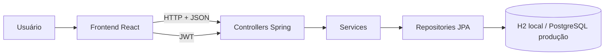
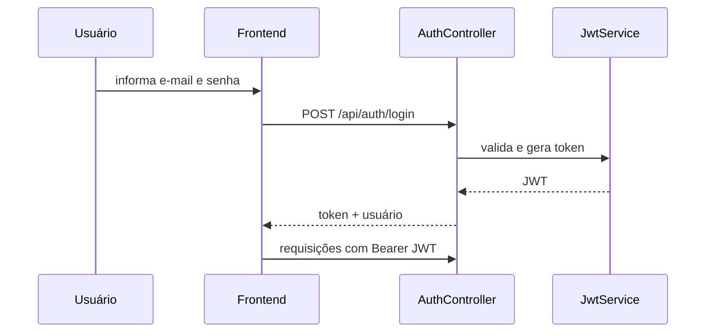

# Arquitetura

## Visão geral

O BemDoar usa uma arquitetura cliente-servidor. O frontend React consome uma API REST em Spring Boot. O backend concentra autenticação, autorização, validações e regras de negócio, persistindo dados por JPA.

## Módulos

- `frontend/src/componentes`: elementos reutilizáveis, layout e proteção de rotas.
- `frontend/src/paginas`: telas organizadas por módulo de negócio.
- `frontend/src/servicos`: cliente HTTP e estado de autenticação.
- `backend/src/main/.../controller`: contratos HTTP e autorização de endpoints.
- `backend/src/main/.../service`: regras de negócio e transações.
- `backend/src/main/.../repository`: persistência.
- `backend/src/main/.../entity`: modelo de dados.
- `backend/src/main/.../dto`: contratos de entrada e saída.

## Fluxo de autenticação

## Limite da plataforma

A interface segue mobile-first e funciona em navegadores móveis, mas permanece uma aplicação web. Não há, nesta baseline, projeto Android, iOS, Flutter ou React Native.
