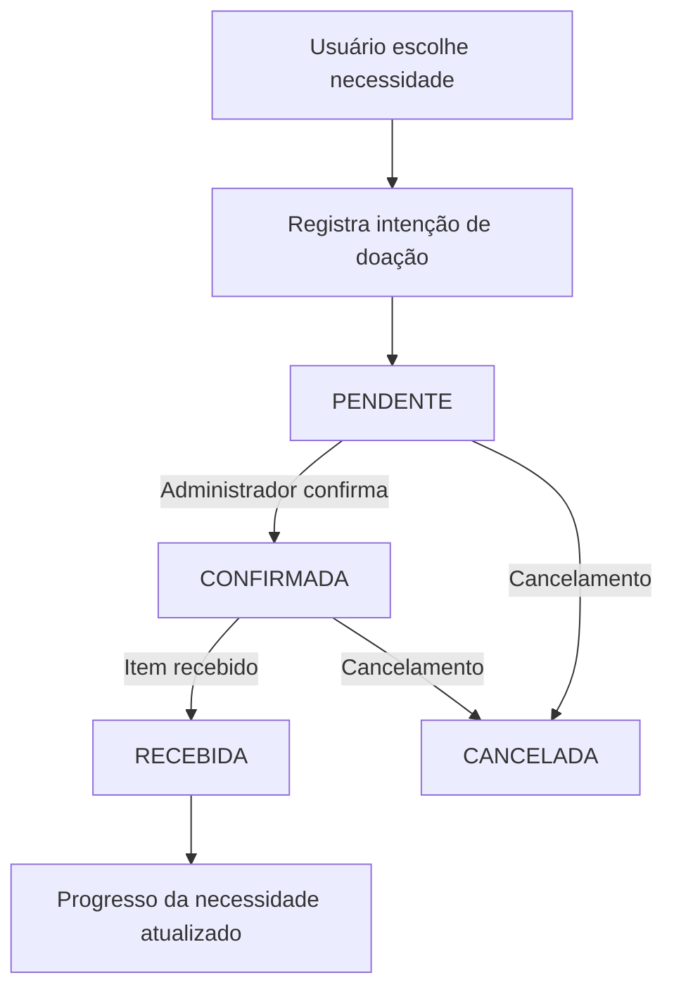

# Casos de uso

## Visitante

- Consultar necessidades, campanhas, oportunidades e ações sociais públicas.
- Consultar indicadores de transparência.
- Criar uma conta e autenticar-se.

## Usuário autenticado

- Registrar e acompanhar doações.
- Candidatar-se a oportunidades de voluntariado.
- Consultar participação e notificações.
- Atualizar dados do próprio perfil.

## Administrador

- Gerenciar categorias e necessidades.
- Confirmar, receber ou cancelar doações.
- Gerenciar campanhas, comunicados e oportunidades.
- Avaliar candidaturas e registrar participações.
- Gerenciar ações sociais, resultados e evidências.
- Atualizar dados institucionais.

## Fluxo principal de doação

